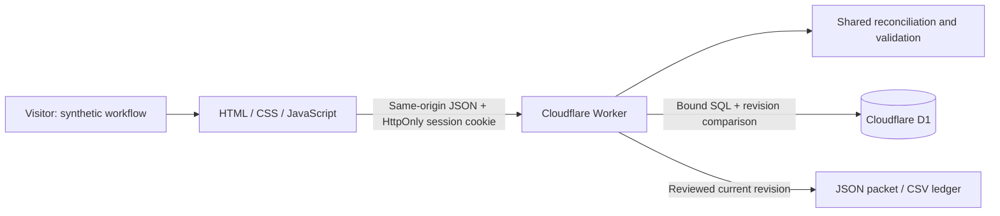

# Close Control architecture

I built Close Control as an independent, synthetic operations concept. I use Odin's public closing materials to frame the problem; the proposed queue, readiness rules and review controls are my design assumptions. This application does not connect to Odin, a bank, an identity provider or a document-signing service.

The browser is plain HTML, CSS and JavaScript. A shared domain module calculates reconciliation, fees, blockers and review hashes. The Cloudflare Worker runs that same module for every accepted operation; browser calculations do not authorise server state. Cloudflare D1 stores isolated session records. No business state is stored in browser local storage.



## Session and storage boundary

`POST /api/session` creates only the known synthetic seed. Its 32-byte random secret is sent in an HttpOnly, SameSite=Strict cookie with a 24-hour lifetime; the cookie is Secure outside localhost development. D1 stores a SHA-256 digest of the secret, not the usable secret itself. State is selected by that digest, never by a visitor-supplied deal or session identifier. A returning valid cookie reads its existing session rather than resetting it.

Expired sessions and rate counters are deleted lazily on API requests. Expired state is inaccessible immediately at its expiry even before physical deletion. This is a demonstration retention policy, not a production retention guarantee or consent system.

Each changing operation requires `expectedRevision`. I validate the operation against the loaded state, then save its result with a bound SQL update constrained by the session identifier, old revision and expiry. Exactly one of two competing writes can win; the other returns `409 STALE_REVISION`. Successful changes advance the global session revision once. Reset also advances it and retains the session's audit history. An import containing only exact canonical duplicates leaves state, revision, audit and review unchanged, with a same-value revision comparison to catch a concurrent write.

## Import and review boundary

Import is a two-step operation. Preview validates both CSV files and returns counts, differences and validation errors without changing state. Its SHA-256 preview hash binds the exact CSV bytes to that session and revision. Apply validates the files again and requires the matching hash, then saves all accepted rows atomically. Invalid files cannot partially update the ledger.

Duplicate external event IDs are idempotent only when the canonical event agrees. Different IDs sharing one settlement reference, currency and amount remain visible and quarantined until an explicit duplicate exclusion. Unassigned receipts require a human match; matching is never inferred from an amount or name. Refunds and reversals retain their settlement parent and reduce its net cash; aggregate adjustments cannot exceed their parent settlement.

Readiness is derived from account funding, exceptions and synthetic human attestations. A review request binds the requested revision and hash. Approval requires that exact current request and an explicit confirmation by the fictional reviewer. The approved record then binds the resulting approved revision and hash. Any later changing operation invalidates all session reviews conservatively. Review and audit fields are excluded from financial/document snapshot content; the revision, normalized derived reconciliation and calculation rule version remain part of its hash.

JSON packet and CSV ledger downloads require an approved, ready current revision. The packet includes the synthetic snapshot, hash, review, reconciliation and audit. A review is evidence of this concept's readiness workflow; it does not claim that a real investment has closed, that regulatory checks passed or that funds moved.

## API contract

The session, state and successful mutation responses contain `{state, queue, reconciliations}`. Preview contains `{valid, errors, summary, diff, previewHash, revision}`; the private proposed `nextState` is never returned. Validation failures use `{error: {code, message, details?}}`. State changes, import and preview require JSON with the fields shown below; unsupported fields are rejected.

| Route | Method | Fields or query |
| --- | --- | --- |
| `/api/session` | POST | Empty JSON object |
| `/api/state` | GET | None |
| `/api/import/preview` | POST | `commitmentsCsv`, `paymentsCsv`, `expectedRevision` |
| `/api/import` | POST | Preview fields plus `previewHash` |
| `/api/match` | POST | `dealId`, `eventId`, `commitmentId`, `expectedRevision` |
| `/api/event/resolve` | POST | `eventId`, `resolution: "duplicate"`, `expectedRevision` |
| `/api/legal` | POST | `dealId`, `metadata`, `expectedRevision` |
| `/api/attest` | POST | `dealId`, `kind`, `attested`, `actor`, `expectedRevision` |
| `/api/fee` | POST | `dealId`, `payer`, `expectedRevision` |
| `/api/review/request` | POST | `dealId`, `expectedRevision` |
| `/api/review/approve` | POST | `dealId`, `reviewer`, `confirmed: true`, `expectedRevision` |
| `/api/reset` | POST | `expectedRevision` |
| `/api/export` | GET | `dealId`, `revision` |
| `/api/export/ledger` | GET | `dealId`, `revision` |

The Worker reads actual body bytes up to 70 KiB, irrespective of a claimed content length. Each CSV is at most 32 KiB and 100 data rows. The domain limits stored events to 500, commitments to 30 and audit entries to 1,000. D1 counters limit creation to 10 sessions per IP per hour, session requests to 120 per minute and writes/previews to 40 per minute. The creation limiter trusts Cloudflare's `CF-Connecting-IP` only at Cloudflare ingress. A missing header uses a shared local-development budget; another hosting proxy would need its own trusted address mechanism. Fixed windows may admit a burst across their boundary; these are demonstration resource controls.

## Run and deployment

From the repository root:

```sh
npm ci
npm test
npx wrangler d1 migrations apply odin-close-control --local
npx wrangler dev --local --ip 0.0.0.0 --port 8787
```

The Worker runs first for every request. It handles `/api/*` and serves other requests through its `ASSETS` binding, adding the same CSP, frame, referrer and permissions headers to static document responses centrally. Local Wrangler uses real SQLite-backed D1 emulation; API tests exercise the Worker and D1 runtime through Miniflare. `wrangler.jsonc` contains an obvious all-zero remote database placeholder. Cloudflare authentication was unavailable during this build, so a live remote D1 deployment could not be verified. A public Cloudflare deployment requires an authorised account, creation of a real D1 database, replacement of that placeholder and application of the migration remotely before deployment. I do not describe local verification as production deployment. No credentials belong in this repository.
