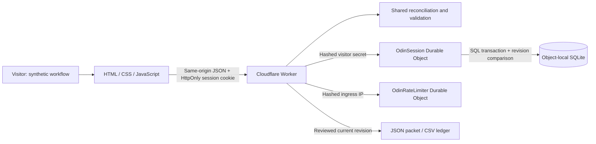

# Close Control architecture

I built Close Control as an independent, synthetic operations concept. I use Odin's public closing materials to frame the problem; the proposed queue, readiness rules and review controls are my design assumptions. This application does not connect to Odin, a bank, an identity provider or a document-signing service.

The browser is plain HTML, CSS and JavaScript. A shared domain module calculates reconciliation, fees, blockers and review hashes. The Cloudflare Worker runs that same module for every accepted operation; browser calculations do not authorise server state. I store each visitor's bounded session in a separate SQLite-backed Durable Object. No business state is stored in browser local storage or eventually consistent KV.



## Session and storage boundary

`POST /api/session` creates only the known synthetic seed. Its 32-byte random secret is sent in an HttpOnly, SameSite=Strict cookie with a 24-hour lifetime; the cookie is Secure outside localhost development. The Worker hashes this secret to route to an object in the `ODIN_SESSIONS` namespace. I store neither the usable secret nor a raw ingress IP in SQLite. There is no public object-ID or session-ID selector. A returning valid cookie reads its existing session rather than resetting it.

Expiry is fixed at creation plus 24 hours; activity does not extend it. Reads, writes and exports check expiry and reject expired state even if physical cleanup has not run. A missing or expired cookie returns `401` and clears the cookie. A later explicit session creation receives a new secret and object; an expired object cannot silently seed itself. Alarms reclaim only Odin's own expired state and rate counters. Cleanup can be delayed by platform availability or quota errors, so I distinguish immediate access expiry from eventual physical deletion.

Each changing operation requires `expectedRevision`. I validate against the loaded state, then use the minimal SQL persistence adapter's synchronous transaction to recheck current expiry and revision and save the JSON and revision together. Asynchronous hashing does not grant a stale write permission: the transaction compares again after calculation. Exactly one of two competing writes can win; the other returns `409 STALE_REVISION`. Successful changes advance the global session revision once. Reset also advances it and retains the session's audit history. An import containing only exact canonical duplicates leaves state, revision, audit and review unchanged, while still checking that revision at commit.

Each session object owns one business row and its request/write counters. A separate `OdinRateLimiter` object, selected by a hash of Cloudflare's ingress IP, limits new sessions. Object creation, alarm cleanup and counter rollover must be serialized so an old cleanup cannot erase a new active window. The adapter initializes only `odin_sessions` and `odin_rate_limits` in these new namespaces. It has no D1 binding, D1 API call, cross-project SQL connection, or persistence fallback. A namespace, SQL or alarm error returns an unavailable-service response; it does not acknowledge an operation using temporary memory.

## Import and review boundary

Import is a two-step operation. Preview validates both CSV files and returns counts, differences and validation errors without changing state. Its SHA-256 preview hash binds the exact CSV bytes to that session and revision. Apply validates the files again and requires the matching hash, then saves all accepted rows atomically. Invalid files cannot partially update the ledger.

Duplicate external event IDs are idempotent only when the canonical event agrees. Different IDs sharing one settlement reference, currency and amount remain visible and quarantined until an explicit duplicate exclusion. Unassigned receipts require a human match; matching is never inferred from an amount or name. Refunds and reversals retain their settlement parent and reduce its net cash; aggregate adjustments cannot exceed their parent settlement.

Readiness is derived from account funding, exceptions and synthetic human attestations. A review request binds the requested revision and hash. Approval requires that exact current request and an explicit confirmation by the fictional reviewer. The approved record then binds the resulting approved revision and hash. Any later changing operation invalidates all session reviews conservatively. Review and audit fields are excluded from financial/document snapshot content; the revision, normalized derived reconciliation and calculation rule version remain part of its hash.

JSON packet and CSV ledger downloads require an approved, ready current revision. The packet includes the synthetic snapshot, hash, review, reconciliation and audit. A review is evidence of this concept's readiness workflow; it does not claim that a real investment has closed, that regulatory checks passed or that funds moved.

## API contract

The session, state and successful mutation responses contain `{state, queue, reconciliations}`. Preview contains `{valid, errors, summary, diff, previewHash, revision}`; the private proposed `nextState` is never returned. Validation failures use `{error: {code, message, details?}}`. State changes, import and preview require JSON with the fields shown below; unsupported fields are rejected.

| Route | Method | Fields or query |
| --- | --- | --- |
| `/api/session` | POST | Empty JSON object |
| `/api/state` | GET | None |
| `/api/import/preview` | POST | `commitmentsCsv`, `paymentsCsv`, `expectedRevision` |
| `/api/import` | POST | Preview fields plus `previewHash` |
| `/api/match` | POST | `dealId`, `eventId`, `commitmentId`, `expectedRevision` |
| `/api/event/resolve` | POST | `eventId`, `resolution: "duplicate"`, `expectedRevision` |
| `/api/legal` | POST | `dealId`, `metadata`, `expectedRevision` |
| `/api/attest` | POST | `dealId`, `kind`, `attested`, `actor`, `expectedRevision` |
| `/api/fee` | POST | `dealId`, `payer`, `expectedRevision` |
| `/api/review/request` | POST | `dealId`, `expectedRevision` |
| `/api/review/approve` | POST | `dealId`, `reviewer`, `confirmed: true`, `expectedRevision` |
| `/api/reset` | POST | `expectedRevision` |
| `/api/export` | GET | `dealId`, `revision` |
| `/api/export/ledger` | GET | `dealId`, `revision` |

The Worker reads actual body bytes up to 70 KiB, irrespective of a claimed content length. Each CSV is at most 32 KiB and 100 data rows. The domain limits stored events to 500, commitments to 30 and audit entries to 1,000. Durable SQL counters limit creation to 10 sessions per IP per hour, session requests to 120 per minute and writes/previews to 40 per minute. The creation limiter trusts Cloudflare's `CF-Connecting-IP` only at Cloudflare ingress. A missing header uses a shared local-development budget; another hosting proxy would need its own trusted address mechanism. Fixed windows may admit a burst across their boundary; these are demonstration resource controls.

## Run and deployment

From the repository root:

```sh
npm ci
npm test
npx wrangler dev --local --ip 0.0.0.0 --port 8787
```

The Worker runs first for every request. It handles `/api/*` and serves other requests through its `ASSETS` binding, adding the same CSP, frame, referrer and permissions headers to static document responses centrally. Local Wrangler and integration tests run real SQLite Durable Objects through Miniflare/workerd. No manual SQL migration or D1 command is required; the exported classes and `new_sqlite_classes` migration in `wrangler.jsonc` create the new Odin namespaces when an authenticated operator deploys.

I checked [current Workers Free support and quotas](research/cloudflare-durable-objects-free.md), including the shared storage allowance and fail-closed over-limit behavior. The [external deployment report](evidence/external-deployment-report.json) records a separately managed Free account, only the two Odin SQLite namespaces and no personal database changes. It reports this architecture live at [the public demo](https://ayo-odin-close-control.ayoahmed-49d.workers.dev/) from source commit `8a734d804d4c3d59f45c09fe34f3f403a9aead3e`; I have not independently inspected the account or provider version here. This environment's exact-host network policy currently blocks public verification. Local tests and a dry run remain local evidence. [The deployment audit](deployment-audit.md) distinguishes the reported deployment from independent checks, and final walkthrough delivery remains held until the public application is independently verified and a complete recording is watched and listened to.
